# Core 0 Boot, Memory Architecture & Decryption Analysis

This document details the reverse engineering findings regarding the Roland MC-101 (ESC2 SoC: Core 0 ARM Cortex-M4 r0p1 Host CPUID `0x410FC241`, Core 1 ARM Cortex-M4 r0p1 DSP CPUID `0x410FC241`) Core 0 boot process, on-the-fly QSPI hardware decryption, physical memory map, Sub-CPU button scanning, and the enhanced soft-decision receiver algorithms developed to exfiltrate firmware via multi-carrier audio modem.

> [!NOTE]
> **Consolidated Master Reference**: For the complete system architecture, global memory map across all peripherals, Silicon Boot ROM disassembly, and undumped regions, refer to the master document: [`docs/system_architecture_and_boot_flow.md`](docs/system_architecture_and_boot_flow.md).
> The reconstructed Core 0 image [`vendor/mc101_sys_v182/dumps/c0_flash_full_clean_3.5mb.bin`](vendor/mc101_sys_v182/dumps/c0_flash_full_clean_3.5mb.bin) has all-zero blocks verified against ciphertext, but non-zero data blocks recovered from live RAM/SRAM may reflect post-boot runtime state rather than pristine factory flash contents.

---

## 1. Executive Summary & Breakthroughs

1. **`0x00000000` Clarification (Silicon Mask ROM vs. ITCM)**:
   - Address `0x00000000` on Core 1 is **not** the silicon Mask ROM.
   - It is the Cortex-M4 **ITCM** (Instruction Tightly Coupled Memory) base, aliased to `0x01100000`.
   - During boot, the bootloader copies factory [`vendor/mc101_sys_v182/extracts/RPG69_C1A/idm1.bin`](vendor/mc101_sys_v182/extracts/RPG69_C1A/idm1.bin) into ITCM. Dumps from `0x00000000` were byte-for-byte identical to `idm1.bin[0x20 : 0x420]`.

2. **Core 0 Decrypted Application Execution in SDRAM (`0x60000000`)**:
   - `0x60000000`–`0x61FFFFFF` is **32 MB External SDRAM**, not read-only XIP SPI Flash.
   - During boot, the first-stage bootloader (`App0`) reads `App1_Main` from QSPI0 Flash offset `0x000C0060`, decrypts the payload into SDRAM at `0x60000000` via the hardware DES/3DES engine (`0x40020000`), and jumps to `0x60000000`.
   - We successfully exfiltrated decrypted machine code directly from `0x60000000` ([vendor/mc101_sys_v182/dumps/c0_app_8kb.bin](vendor/mc101_sys_v182/dumps/c0_app_8kb.bin), SHA-256: `55a39b5a271adf093014d5d6221c193f9c469d5589e181baa28caa80c199dbe2`).
   - *Crucial Finding on Runtime Dumps*: Because [`c0_flash_full_clean_3.5mb.bin`](vendor/mc101_sys_v182/dumps/c0_flash_full_clean_3.5mb.bin) was dumped from live SDRAM, its writable `.data` segment (`0x602C99F4`–`0x6031279C`) contains mutated RTOS state, and its load region tail (`0x6031279C`–`0x603565B0`) was zeroed by the `.bss` initialization loop.

3. **Core 0 ITCM Direct Bus Access (`0x01000000`)**:
   - Core 1 can read Core 0 ITCM directly over the AXI system bus without triggering BusFaults.
   - We successfully dumped the live Core 0 Vector Table at `0x01000000` ([vendor/mc101_sys_v182/dumps/c0_itcm_256b.bin](vendor/mc101_sys_v182/dumps/c0_itcm_256b.bin), SHA-256: `a0e00f512f87931b886a40d2d4bca46a73b4e2a90e3170ff6994d330403aaa91`).

---

## 2. Core 0 Vector Table & Exception Handlers

The live vector table dumped from `0x01000000` reveals Core 0's runtime configuration:

| Vector | Address | Value | Target Handler / Description |
|---|---|---|---|
| **0** | `0x01000000` | `0x01050800` | **Initial Main Stack Pointer (MSP)** |
| **1** | `0x01000004` | `0x60000001` | **Reset Handler** (Entry Point in decrypted QSPI XIP) |
| **2** | `0x01000008` | `0x01005D9D` | NMI Handler |
| **3** | `0x0100000C` | `0x01005D9F` | HardFault Handler |
| **4** | `0x01000010` | `0x01005DA1` | MemManage Handler |
| **5** | `0x01000014` | `0x01005DA3` | BusFault Handler |
| **6** | `0x01000018` | `0x01005DA5` | UsageFault Handler |
| **7..10** | `0x0100001C` | `0x00000000` | Reserved |
| **11** | `0x0100002C` | `0x01005F05` | **SVCall Handler** ($\mu$T-Kernel System Calls) |
| **12** | `0x01000030` | `0x01005DA9` | DebugMonitor Handler |
| **13** | `0x01000034` | `0x00000000` | Reserved |
| **14** | `0x01000038` | `0x01005DCD` | **PendSV Handler** (OS Context Switcher) |
| **15** | `0x0100003C` | `0x01005FA5` | **SysTick Handler** (OS Kernel Heartbeat) |
| **16..** | `0x01000040` | ... | Peripheral IRQ Vector Table |

Key Observation: Vector 1 points to `0x60000001`, proving that Core 0 executes directly out of QSPI flash at `0x60000000` on cold reset before relocating its vectors to ITCM (`0x01000000`).

---

## 3. Core 0 CRT0 Startup Sequence Disassembly

Analysis of `vendor/mc101_sys_v182/dumps/c0_app_8kb.bin` at `0x60000000`:

```assembly
60000000:   48ae        ldr     r0, [pc, #696]   ; Load AIRCR address (0xE000ED0C)
60000002:   6801        ldr     r1, [r0, #0]
60000004:   f64f 02ff   movw    r2, #63743       ; 0xF8FF
60000008:   ea01 0102   and.w   r1, r1, r2
6000000c:   4aac        ldr     r2, [pc, #688]   ; Load Unlock Key (0x05FA0300)
6000000e:   ea41 0102   orr.w   r1, r1, r2
60000012:   6001        str     r1, [r0, #0]     ; Unlock AIRCR / PRIGROUP
60000014:   f04f 0010   mov.w   r0, #16
60000018:   f380 8811   msr     BASEPRI, r0      ; Set BASEPRI = 16
6000001c:   f000 f8bc   bl      0x60000198       ; Reset Hardware DMA/Crypto Engine
```

### Resetting Hardware DMA/Crypto Engine (`0x60000198`)

```assembly
60000198:   mov.w   r0, #0
6000019c:   str     r0, [0x40001000]   ; Reset Engine Control
600001a0:   str     r0, [0x40001020]   ; Clear Channel Control
600001a4:   str     r0, [0x40001024]   ; Clear Channel Status
600001a8:   str     r0, [0x40001028]   ; Clear Source Address
600001ac:   str     r0, [0x4000102C]   ; Clear Destination Address
600001b0:   mov.w   r0, #0x80000000
600001b4:   str     r0, [0x40001000]   ; Set Enable / Global Reset Flag
600001b8:   bx      lr
```

### The Master Memory Copy Routine (`0x600001BA`)

```assembly
; Function arguments:
; r0: Destination address (ITCM / SRAM / MMIO)
; r1: Byte transfer count
; r2: Source address (Flash / Memory)
600001ba:   str     r2, [0x40001028]   ; Program DMA Source Address
600001be:   str     r0, [0x4000102C]   ; Program DMA Destination Address
600001c2:   lsr.w   r4, r1, #6         ; Compute 64-byte burst count
...
600001d6:   mov.w   r5, #0x18000000    ; DMA Burst Mode Command
600001da:   str     r5, [0x40001024]   ; Trigger DMA transfer
...
600001ec:   and.w   r5, r5, #0x70000   ; Poll Status bits [18:16]
600001f0:   cmp.w   r5, #0x50000       ; Wait until status == COMPLETE
600001f4:   bne     poll_loop
```

### Relocating Vector Table & Launching OS

```assembly
6000011c:   ldr     r0, [0x600003c0]   ; 0x01050800
6000011e:   msr     MSP, r0            ; Set Main Stack Pointer
60000122:   bl      0x6001993c         ; Initialize Platform Hardware
60000126:   ldr.w   r8, =0xE000ED08    ; VTOR Address
6000012a:   ldr.w   r9, =0x01000000    ; Core 0 ITCM Base
6000012e:   str.w   r9, [r8]           ; Set VTOR = 0x01000000 (ITCM vectors active!)
60000132:   b.w     0x60019946         ; Jump to Main Kernel Entry Point
```

---

## 4. ARM Compiler Scatterload Table & Memory Layout (`0x602C9904`)

Core 0 executes standard ARM Compiler (`armcc`) runtime initialization. Entry point `0x60000000` performs initial system setup and invokes `__scatterload` (`0x600003E8`), which parses the scatterload region table located in SDRAM at **`0x602C9904`** (file offset `0x2C9904`):

```
Idx  SDRAM File Addr   Src (Load)   Dst (Exec)   Length       Handler / Action                    Region Description
==================================================================================================================================
0    0x602C9904        0x60000000   0x60000000   0x0031279C   __scatterload_null (NOP / In-place) SDRAM Text / Read-Only Data (In-place)
1    0x602C9914        0x60000000   0x60000000   0x0031279C   __scatterload_null (NOP / In-place) SDRAM Text / Read-Only Data (In-place)
2    0x602C9924        0x6031279C   0x01000000   0x00000400   __scatterload_copy (Memcpy)         Core 0 ITCM Vector Table
3    0x602C9934        0x60312B9C   0x01000400   0x00042CA0   __scatterload_copy (Memcpy)         Core 0 ITCM Fast Code
4    0x602C9944        0x6035583C   0x20000000   0x00000290   __scatterload_copy (Memcpy)         Shared SRAM Data Chunk 1
5    0x602C9954        0x60355ACC   0x20000290   0x00000AAC   __scatterload_copy (Memcpy)         Shared SRAM Data Chunk 2
6    0x602C9964        0x60356578   0xE0043000   0x00000038   __scatterload_copy (Memcpy)         Hardware Peripheral / Debug Data
7    0x602C9974        0x6031279C   0x6031279C   0x0084D864   __scatterload_zeroinit (Memset 0)   SDRAM Primary BSS (Overlays Load Region)
8    0x602C9984        0x6031279C   0x61700000   0x0000AC40   __scatterload_zeroinit (Memset 0)   SDRAM Upper BSS Chunk 1
9    0x602C9994        0x6031279C   0x61800000   0x007C5890   __scatterload_zeroinit (Memset 0)   SDRAM Upper BSS Chunk 2 (Audio / Wave RAM)
10   0x602C99A4        0x6035583C   0x01050000   0x00000800   __scatterload_zeroinit (Memset 0)   ITCM BSS
11   0x602C99B4        0x60356578   0x20000D3C   0x00018EB8   __scatterload_zeroinit (Memset 0)   Shared SRAM BSS
12   0x602C99C4        0x60356578   0x40048000   0x00000250   __scatterload_zeroinit (Memset 0)   Internal On-Chip RAM BSS 1
13   0x602C99D4        0x60356578   0x40068000   0x00000200   __scatterload_zeroinit (Memset 0)   Internal On-Chip RAM BSS 2
14   0x602C99E4        0x603565B0   0xE0043038   0x000003BC   __scatterload_zeroinit (Memset 0)   Hardware Peripheral BSS
==================================================================================================================================
```

### 4.1 Resolution of the "277 KB Zero Hole"
1. **Load Regions (Entries 2–6)**:
   - The `.itcm` payload (Vector table + Code = `274,592` bytes) is packed at SDRAM load address `0x6031279C`–`0x6035583C`.
   - The `.sram_data` payload (`3,388` bytes) is packed at `0x6035583C`–`0x60356578`.
   - The `.e0043000` payload (`56` bytes) is packed at `0x60356578`–`0x603565B0`.
   - The total payload length is exactly `0x603565B0 - 0x60000000 = 0x3565B0` (3,499,440 bytes), matching `RPG69_C0A_up.bin` header field `+0x44 = 0x003565B0`!
2. **Zero-Init Overlay (Entry 7)**:
   - After copying the load regions to ITCM and SRAM, `__scatterload_zeroinit` is called on `dst = 0x6031279C, len = 0x0084D864` (`8,706,148` bytes, ending at `0x60B60000`).
   - The linker deliberately placed the uninitialized BSS buffer in SDRAM starting at `0x6031279C` to reuse the memory occupied by the load images once they have been copied.
   - Therefore, when memory was dumped from live SDRAM at runtime, the region `0x6031279C`–`0x603565B0` was naturally all zeros!
3. **Dirty Runtime `.data`**:
   - The range `0x602C99F4`–`0x6031279C` (`298,408` bytes, between the scatterload table and the BSS start) is in-place writable `.data` in SDRAM.
   - Dumps taken while the OS was running contain mutated task handles, semaphores, and initialized state flags. Booting from this dirty data will cause crashes unless pristine factory `.data` is used.

---

## 5. Sub-CPU Interface, Button Mapping & Boot-Time Modes

### 5.1 Sub-CPU Architecture & Communication
The MC-101 front panel (buttons, knobs, encoders, pads, LEDs) and power sequencing are managed by a dedicated **Sub-CPU** (companion microcontroller).
- **Boot Sequence**: At power-on, the Sub-CPU initializes its I/O lines, verifies battery/power status, de-asserts `RESET_L` on the main ESC2 SoC, and begins a periodic 2 ms scan of the button matrix.
- **Button Streaming**: The Sub-CPU does **not** interpret button holds or toggle hardware strapping pins (`0x40026040`) at boot. It streams raw button press/release event packets over a dedicated high-speed serial/SPI interface to Core 0.
- **Sub-CPU Firmware Update**: Holding **`[EXIT]`** at cold boot enters Sub-CPU update mode (`= Upd Sub Cpu =`). The Sub-CPU firmware image is stored inside Core 0 flash and is reflashed via serial bootloader commands.

### 5.2 Corrected Logical Button ID Mapping

Analysis of the button lookup table at `0x602caba4` (which begins with `SHIFT`, correcting an earlier off-by-one indexing assumption) reveals the logical button IDs parsed by Core 0:

| Button ID | Hex ID | Physical MC-101 Control | Hardware Role / Function |
|---|---|---|---|
| **`0`** | `0x00` | **`[SHIFT]`** | Global modifier (tested via `IsButtonPressed(0)`) |
| **`1`** | `0x01` | **`[PROJECT]`** | Project menu (or USB Storage at cold boot) |
| **`3`** | `0x03` | **`[<] MEAS`** | Measure scroll back |
| **`4`** | `0x04` | **`[>] MEAS`** | Measure scroll forward |
| **`5`** | `0x05` | **`[>] PLAY/STOP`** | Sequencer playback |
| **`10`** | `0x0A` | **`[MULTI FX]`** | Multi-FX parameter edit (under Track 4) |
| **`11`** | `0x0B` | **`[SOUND]`** | Track 1 select button (under knob `C1`) |
| **`12`** | `0x0C` | **`[FILTER]`** | Track 2 select button (under knob `C2`) |
| **`13`** | `0x0D` | **`[MOD]`** | Track 3 select button (under knob `C3`) |
| **`15`** | `0x0F` | **`[TEMPO]`** | Tempo tap / modifier |
| **`16`** | `0x10` | **`[EXIT]`** | Cancel / Exit (Sub-CPU update at boot) |
| **`17`** | `0x11` | **`[ENTER]`** | **The `[VALUE]` knob button push!** |
| **`18`** | `0x12` | **`[CLIP]`** | Clip mode button (top left column) |
| **`19`** | `0x13` | **`[SEQ]`** | Sequence edit mode |
| **`20`** | `0x14` | **`[NOTE]`** | Note input mode |
| **`21`** | `0x15` | **`[SCATTER]`** | Scatter effect mode |
| **`22..37`**| `0x16..0x25` | **`[PAD 1]` .. `[PAD 16]`** | Step sequencer / performance pads 1–16 |

### 6.3 Core 0 Boot-Time Button Modes
During startup, Core 0 inspects the boot button bitmask in SRAM populated by the Sub-CPU:

| Button / Combination | Mode Triggered | Purpose & Disassembly Location |
|---|---|---|
| **`[SHIFT]` held** | **SD Card Update Mode** (`= UPDATE =`) | Handled by `App0` recovery loader; reads update binaries (e.g. `RPG69_C1A_up.bin`) from SD card root. |
| **`[PROJECT]` held** | **USB Storage Mode** (`USB STORAGE`) | Exposes SD card as USB Mass Storage device for project backups. |
| **`[EXIT]` held** | **Sub-CPU Flash Mode** (`= Upd Sub Cpu =`) | Re-flashes Sub-CPU companion microcontroller firmware. |
| **`[CLIP]` + `[SOUND]` + `[MOD]` (Chord)** | **Factory Test Menu** (`TEST MENU[VALUE]`) | Disassembly at `0x60047ec4`–`0x60047fe4`. Enables Screen 9 test diagnostics. |

### 6.4 The Factory Test Menu Trigger: Cold Boot 3-Button Chord
The Core 0 startup state machine at `0x60047ec4` strictly verifies that **exactly three buttons** are held at power-on:

```armasm
0x60047ec4: bl   0x6001a4cc   ; GetBootHeldButtonCount()
0x60047ec8: cmp  r0, #3       ; Are EXACTLY 3 buttons held?
0x60047eca: bne  0x60047f32   ; If not 3, skip to normal boot
0x60047f0e: movs r0, #0x0b    ; Button 11 (0x0B) = [SOUND] (Track 1)
0x60047f10: bl   0x6001a4d6   ; IsBootButtonHeld(SOUND)
0x60047f14: cbz  r0, 0x60047f32
0x60047f16: movs r0, #0x0d    ; Button 13 (0x0D) = [MOD] (Track 3)
0x60047f18: bl   0x6001a4d6   ; IsBootButtonHeld(MOD)
0x60047f1c: cbz  r0, 0x60047f32
0x60047f1e: movs r0, #0x12    ; Button 18 (0x12) = [CLIP] (Left column top)
0x60047f20: bl   0x6001a4d6   ; IsBootButtonHeld(CLIP)
0x60047f24: cbz  r0, 0x60047f32
0x60047f26: movs r5, #1       ; Boot Mode = 1 (Test Mode)
...
0x60047fe0: movs r1, #1
0x60047fe4: bl   0x600421ec   ; Sets *0x602f241c = 1 and enters Screen 9 (TEST MENU)
```

#### Why `[SHIFT] + [TEMPO]` Failed at Runtime
At runtime, both the Project Menu (`[PROJECT]`) and Utility Menu (`[SHIFT] + [FILTER]`) dispatch input through `0x60055a74`. In that menu handler:
1. `0x60055b26` checks if `[SHIFT] + [TEMPO]` is pressed.
2. It calls `0x60057dcc`, which tests `*0x602f241c` (`TestModeActive` flag).
3. If the unit was **not** cold-booted with the 3-button chord, `*0x602f241c == 0`, and `0x60057dd4: bxmi lr` returns immediately without opening the test menu.
4. Execution falls through to the global panel dispatcher, where `[SHIFT] + [TEMPO]` is executed as standard **`[WRITE]`** (Save Project).

---

## 6. Pathways for Running Custom Firmware on Core 0

A single mistake in writing to SPI Flash Sector 0 (`0x00000000`) risks hard-bricking the device with zero fallback. Furthermore, modifying physical flash Sector 0 carries unnecessary risk when Core 1 provides a 100% safe, volatile staging ground. Therefore, the **Core 1 Stage-2 Bootstrap** provides the ultimate, 0%-risk solution.

### Option 1: The Core 1 "Stage-2 Bootstrap" (Recommended: 0% Brick Risk)

#### Architectural Foundation
- **Core 1 Firmware is Unencrypted**: `RPG69_C1A_up.bin` / `idm1.bin` is 100% unencrypted and can be patched and flashed with complete safety via standard SD card update.
- **Shared AXI Interconnect**: Core 0 and Core 1 share the exact same AXI bus matrix. Core 1 has unrestricted read and write access to Core 0 ITCM (`0x01000000`), SRAM (`0x20000000`), and Core 0's vector table.
- **Core 0 Executes from ITCM**: Core 0 only executes from flash (`0x60000000`) for CRT0; CRT0 copies the entire kernel to `0x01000400`, sets `VTOR = 0x01000000`, and runs the OS out of ITCM.

```mermaid
sequenceDiagram
    autonumber
    participant Flash as SPI Flash (Stock Encrypted C0)
    participant C0 as Core 0 (Cortex-M4)
    participant C1 as Core 1 (Patched idm1.bin)
    participant ITCM as Core 0 ITCM (0x01000000)

    Note over Flash,C0: Normal Safe Factory Boot
    Flash->>C0: Boot ROM configures OTFDEC & decrypts stock C0
    C0->>ITCM: CRT0 copies vector table & kernel to ITCM (0x01000000)
    C0->>C1: Core 0 wakes Core 1 via SYSCTRL (0x40000000)
    Note over C1: Core 1 starts running our custom code
    
    rect rgb(20, 40, 20)
    Note over C1,ITCM: The Stage-2 Takeover
    C1->>ITCM: Writes custom Core 0 payload into ITCM (0x01050000)
    C1->>ITCM: Overwrites Core 0 SysTick vector (0x0100003C) to point to payload
    C0->>ITCM: On next 1ms SysTick, Core 0 branches into custom code!
    Note over C0: Core 0 disables interrupts, sets new MSP/VTOR, runs custom OS!
    end
```



#### Step-by-Step Takeover Procedure
1. **Leave Flash Stock**: Keep factory encrypted `RPG69_C0A_up.bin` in flash. Physical Sector 0 remains untouched.
2. **Boot Normally**: The Boot ROM and OTFDEC decrypt stock Core 0 normally. Core 0 initializes RTOS and launches Core 1.
3. **In-Memory Hot-Swap via Core 1**:
   - Core 1 stages custom Core 0 binary into Core 0 ITCM scratch (`0x01050000`) or SRAM.
   - Core 1 replaces the Core 0 SysTick vector at `0x0100003C` with the entry point of the payload.
   - Within 1 ms, Core 0's SysTick timer fires, branching Core 0 into the custom payload with full privileged Cortex-M4 permissions.
   - The payload executes `cpsid i`, relocates `VTOR`, points `MSP` to fresh stack memory, and begins executing custom firmware.
4. **Safety**: If the custom code crashes, simply power-cycle the unit—the device boots cleanly back into factory firmware with 0% risk of bricking.

---

## 7. Analysis & Refutation of Hardware Encryption Oracle (Option 3)

The hypothesis that the on-chip hardware cipher engine could be used as an "encryption oracle" (to encrypt custom firmware using the hidden key) was thoroughly evaluated and refuted based on hardware realities:

1. **Subkey Schedule Reversal in Feistel Block Ciphers**:
   In DES and Feistel block ciphers, encryption and decryption are **not** the same operation:
   - **Encryption**: Uses subkeys $K_1 \rightarrow K_2 \rightarrow \dots \rightarrow K_{16}$.
   - **Decryption**: Uses subkeys $K_{16} \rightarrow K_{15} \rightarrow \dots \rightarrow K_1$.
   The hardware OTFDEC cipher core is hardwired specifically in **decrypt mode** for flash read operations.
2. **Unidirectional Read-Only Pipeline**:
   The OTFDEC is an in-line read filter placed between the QSPI memory controller and the AXI bus:
   $$\text{SPI Flash (Ciphertext)} \longrightarrow \text{QSPI Controller} \longrightarrow \text{OTFDEC Decryptor} \longrightarrow \text{AXI Bus (Plaintext)}$$
   SPI flash cannot be encrypted on write using memory-mapped `str` instructions; writing SPI flash requires SPI controller command FIFOs (sector-erase `0x20`, page-program `0x02`).
3. **No Memory-to-Memory DMA Mode**:
   There is no DMA coprocessor mode allowing the CPU to pass plaintext buffers in SRAM through the cipher core to generate ciphertext.
4. **Key Registers are Write-Only**:
   Key registers at `0x40020400` are protected by hardware interlocks; reads return `"IndivCode"`. The key cannot be read out to compute reversed subkeys in software.

---

## 8. Cryptographic Resolution & Clean Firmware Extraction

### 8.1 Breakthrough: The Master 3DES Key Table (`0x012023B0`)
The complete cryptographic key derivation mechanism was reversed from `App0` (`0x01000608`) and the silicon Mask Boot ROM (`0x01200298`):

1. **Key Table Architecture**:
   - The Silicon Boot ROM maintains a 24-byte-per-entry Master Key Table linked at **`0x012023B0`** in ROM space.
   - The entry offset is computed as:
     $$\text{Table Address} = 0x012023B0 + (\text{Key Index} \times 24)$$
   - In `vendor/mc101_sys_v182/RPG69_C0A_up.bin`, container Word 21 (`0xB6020001`) specifies **Key Index `0xB6` (182)** and **Mode 2 (3-Key 3DES)**.
   - Address computation:
     $$0x012023B0 + (182 \times 24) = 0x012023B0 + 0x1110 = \mathbf{0x012034C0}$$

2. **Silicon ROM Key Material (Index `0xB6`)**:
   - Reading 24 bytes (6 words) from `0x012034C0` in [`vendor/mc101_sys_v182/dumps/bootrom_full_16k.bin`](vendor/mc101_sys_v182/dumps/bootrom_full_16k.bin).

3. **Hardware Key Register & Bus Ordering (`0x01003B18` / `0x01202604`)**:
   The hardware DES engine (`0x40020400`–`0x40020414`) in decrypt mode (`r7 == 1`) inverts the key stage order:
   - $\text{Key 1} = [w_4, w_5]$
   - $\text{Key 2} = [w_2, w_3]$
   - $\text{Key 3} = [w_0, w_1]$

4. **Hardware AXI FIFO Word Swapping**:
   The DES FIFO interfaces (`0x40020000` In / `0x40020200` Out) stream data via 32-bit DMA. Each 64-bit DES block consists of two 32-bit words that are byte-packed big-endian and word-swapped ($[W_1 : W_0]$).

### 8.2 Verification & Decryption Tool
- The complete decryption engine was implemented in [`tools/decrypt_c0a.py`](tools/decrypt_c0a.py).
- Decrypted binary output: [`vendor/mc101_sys_v182/extracts/RPG69_C0A/App1_Main_decrypted.bin`](vendor/mc101_sys_v182/extracts/RPG69_C0A/App1_Main_decrypted.bin) (3,499,440 bytes).
- **Verification Results**:
  - **Text Section (`0x000000`–`0x2C9904`, 2.92 MB)**: **0 differing bytes (100.0000% exact match)** against live SDRAM!
  - **ITCM Fast Code (`0x312B9C`–`0x35583C`, 273.5 KB)**: **0 differing bytes (100.0000% exact match)** against live Core 0 ITCM!
  - **Pre-boot ITCM Vector Table (`0x31279C`–`0x312B9C`, 1024 B)**: Restores pristine, pre-boot exception vectors.
  - **Load Region Tail (278 KB "Zero Hole")**: 100% recovered from ciphertext, eliminating all `.bss` zeroing artifacts.
  - **Pristine `.data` (`0x2C99F4`–`0x31279C`, 298.4 KB)**: 163 bytes that were mutated by runtime RTOS handles are fully restored to factory initial values.
  - **SHA-256 Checksum**: `92a4930f286f4c404f3fcc308fd7ba63fa8243ef339fb8b2deeb625cd524e08d`.

### 8.3 Generalization Across Partitions
The key derivation algorithm was further proven on physical flash partition `App0_UPD` (`vendor/mc101_sys_v182/dumps/physical_sector0_768k.bin` offset `0x40000`):
- Container Word 21 specifies **Key Index `0xB5` (181)**.
- Decryption of `App0_UPD` payload yielded the exact same CRT0 entry point (`0x680148AE`), confirming the key table applies across all Roland ESC2 firmware partitions.
