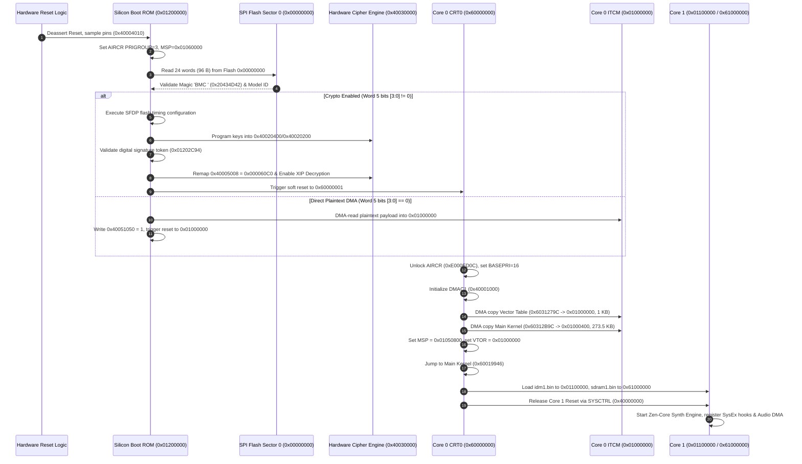

# Roland BMC (ESC2) SoC: System Architecture, Memory Layout & Boot Process

**Target Platform**: Roland MC-101 Groovebox / Roland BMC (ESC2) Platform  
**Target Firmware**: System Version 1.82 (Build 14423, 2023-05-17)  
**Status**: Consolidated Architectural Reference  

---

## 1. Executive Summary & Document Scope

This document provides a single, consolidated source of truth for the reverse engineering of the **Roland BMC (ESC2) System-on-Chip (SoC)** powering the Roland MC-101 (and sibling MC-707). It integrates findings across hardware DMA memory probes, silicon Boot ROM disassembly, firmware container analysis, and live multi-core debugging.

Specifically, this document details:
1. **The Complete Hardware Memory & Address Range Layout** across both ARM Cortex-M4 cores, bus bridges, tightly-coupled memories (TCM), external memories, and peripheral MMIO blocks.
2. **Firmware Artifacts & Storage Interactions**, showing how [`vendor/mc101_sys_v182/dumps/bootrom_full_16k.bin`](vendor/mc101_sys_v182/dumps/bootrom_full_16k.bin), [`vendor/mc101_sys_v182/dumps/c0_flash_full_clean_3.5mb.bin`](vendor/mc101_sys_v182/dumps/c0_flash_full_clean_3.5mb.bin), [`vendor/mc101_sys_v182/extracts/RPG69_C1A/idm1.bin`](vendor/mc101_sys_v182/extracts/RPG69_C1A/idm1.bin), [`vendor/mc101_sys_v182/extracts/RPG69_C1A/sdram1.bin`](vendor/mc101_sys_v182/extracts/RPG69_C1A/sdram1.bin), and QSPI content partitions interact with the system.
3. **The End-to-End Silicon Boot Process**, from cold reset pin release to the launch of the OS and Zen-Core sound synthesis engine.
4. **Audit of Contradictions & Corrections**, systematically resolving outdated hypotheses and documenting verified facts.
5. **Inventory of Undumped System Regions**, explicitly identifying unextracted memory spaces (such as Physical SPI Flash Sector 0) and presenting actionable extraction plans.

---

## 2. Complete Hardware Memory & Address Range Layout

The Roland BMC (ESC2) SoC features a dual-core ARM Cortex-M4 configuration connected via a high-performance 32-bit AXI/AHB crossbar matrix:
- **Core 0**: Main Host / Application Processor (**ARM Cortex-M4 r0p1**, CPUID `0x410FC241`) running $\mu$T-Kernel / TOPPERS RTOS. Handles UI, display, sequencer, SD Card storage, USB stack, and high-level MIDI.
- **Core 1**: Sound Engine & Zen-Core DSP Coprocessor (**ARM Cortex-M4 r0p1**, CPUID `0x410FC241`). Runs bare-metal synthesis pipelines, voice allocation, filter modulation, effect processing, and low-latency audio DMA. Features separate Harvard ICode/DCode and System buses.

```mermaid
graph TD
    subgraph Core 0 Address Space
        C0_ITCM["0x01000000: Core 0 ITCM (512 KB)<br/>Live Vectors & Kernel"]
        C0_SDRAM["0x60000000 - 0x60B60000: Shared SDRAM<br/>App1_Main, CRT0, System BSS"]
    end

    subgraph Core 1 Address Space
        C1_ALIAS["0x00000000: Local ITCM Alias (256 KB)"]
        C1_ITCM["0x01100000: Core 1 ITCM Physical (256 KB)<br/>idm1.bin (Sound Vectors & Hooks)"]
        C1_SDRAM["0x61000000 - 0x61389B1C: Shared SDRAM<br/>sdram1.bin (Zen-Core DSP Engine)"]
        C1_AXI["0x0C000000: Chip 1 Direct AXI Aperture (16 MB)<br/>Direct hardware read of QSPI1 Flash"]
    end

    subgraph Shared System Fabric & Bus Interconnect
        BROM["0x01200000: Silicon Mask Boot ROM (16 KB)"]
        MBOX["0x01140000: Inter-Core IPC Mailbox (4 KB)"]
        SRAM["0x20000000: System SRAM (768 KB+)<br/>Audio Ping-Pong Buffers, Stacks, BSS"]
        MMIO["0x40000000 - 0x40075000: Peripheral MMIO<br/>SYSCTRL, DMAC0/1, QSPI0/1, Cipher Engine"]
        EXT_SDRAM["0x60000000 - 0x61FFFFFF: Physical SDRAM (32 MB Total)<br/>Shared across AXI Bus Matrix"]
    end

    C0_ITCM <-->|AXI Matrix Cross-Core Read/Write| Shared System Fabric
    C1_ITCM <-->|AXI Matrix Cross-Core Read/Write| Shared System Fabric
    C0_SDRAM <--> EXT_SDRAM
    C1_SDRAM <--> EXT_SDRAM
```

### 2.1 Master System Address Map

| Base Address | Limit Address | Size | Memory Type | Bus / Master | Purpose & Firmware Interaction |
|---|---|---|---|---|---|
| **`0x00000000`** | `0x0003FFFF` | 256 KB | ITCM Alias | Core 1 Local | Core 1 local alias to its own ITCM (`0x01100000`). Contains `idm1.bin` code and vector table. |
| **`0x01000000`** | `0x0107FFFF` | 512 KB | ITCM | Core 0 (Direct), Core 1 (AXI) | **Core 0 ITCM**. Houses Core 0 Vector Table (`0x01000000`, 1 KB) and Core 0 Kernel executable (`0x01000400`, 273.5 KB) relocated from flash at boot. Core 1 has full read/write access. |
| **`0x01050800`** | `0x0107FFFF` | ~190 KB | ITCM Scratch / Stack | Core 0 | Core 0 runtime Main Stack Pointer (`MSP = 0x01050800`), Boot ROM MSP (`0x01060000`), dynamic allocations. |
| **`0x01100000`** | `0x0113FFFF` | 256 KB | ITCM | Core 1 (Direct), Core 0 (AXI) | **Core 1 ITCM Physical Base**. Populated by Core 0 with `idm1.bin` during startup. Core 1 vector table is at offset `0x20`. |
| **`0x01140000`** | `0x01140FFF` | 4 KB | On-Chip SRAM / Registers | Shared (AXI) | **Inter-Core IPC Mailbox**. Ring buffers and synchronization semaphores for inter-processor messaging (`0x0114077C`, `0xDA3776D0`). |
| **`0x01200000`** | `0x01203FFF` | 16 KB | Mask ROM | Read-Only (All) | **Silicon Boot ROM**. Contains hardware reset entry point (`0x012000D1`), bootstrap pin sampler, SPI Flash driver, JEDEC SFDP parser, master 3DES key table (`0x012023B0`), and cipher configuration routines. **Upper limit is strictly `0x01203FFF`**; reading `0x01204000` causes an unmapped bus timeout. |
| **`0x0C000000`** | `0x0CFFFFFF` | 16 MB | Direct QSPI NOR Flash | Core 1 / DMAC1 (AXI) | **Chip 1 Direct QSPI NOR Flash AXI Aperture**. Direct hardware-mapped window to the entire 16 MB Chip 1 NOR flash (`MX25L128`). Core 1 and DMAC1 read synthesis code (`C1A` at `0x0C000000`) and wavetables (`C1C` at `0x0C400000`) directly via single-cycle or burst AXI loads without CPU driver arbitration or FIFO stalls. |
| **`0x20000000`** | `0x200BFFFF` | 768 KB+ | System SRAM | Shared (AXI) | **Main System SRAM**: Holds Core 1 data section (`0x20000000`–`0x20000D3C`), zero-initialized BSS (`0x20000D3C`–`0x20027FFC`), audio ping-pong buffers (`0x20020000`), engine buffers (`0x20080000`), Core 1 stack (`0x200A91C8`), and audio DMA callbacks (`0x200A7D88`). |
| **`0x40000000`** | `0x40000034` | 56 B | MMIO | APB Bridge | **SYSCTRL / CRM**: Clock & Reset Management. Core 1 reset release, PLL clocks, low-power modes. |
| **`0x40001000`** | `0x40001040` | 64 B | MMIO | AXI Matrix | **DMAC0 Controller**: Master system DMA engine 0 (source `+0x28`, destination `+0x2C`, burst command `+0x24`). Used by Core 0 CRT0 to copy flash load regions to ITCM/SRAM, and used by diagnostic memory probes. |
| **`0x40003000`** | `0x40003034` | 56 B | MMIO | APB Bridge | System Peripheral / Interconnect Bridge. |
| **`0x40004000`** | `0x400040EC` | 240 B | MMIO | APB Bridge | **QSPI0 Hardware Controller**: Master hardware registers (`0x40004000`–`0x4000404F`) and **QSPI0 Read/Write FIFO buffer (`0x40004050`–`0x400040EC`)**. Residual flash data (build tag, `"IndivCode"`) remains in this FIFO after boot reads. |
| **`0x40005000`** | `0x400050A4` | 168 B | MMIO | APB Bridge | **System Interconnect & Remap**: Controls bus window routing. |
| **`0x40010000`** | `0x400103FF` | 1 KB | On-Chip RAM | AHB/APB | **On-Chip Driver State RAM**: Driver context structures for QSPI0 (`0x40010000`, 72 B), QSPI1 (`0x40010048`, 72 B), and CS0–CS3 flash device geometry tables (`0x40010090`–`0x400103EF`). Zeroed by Boot ROM (`0x012000FC`) and Core 0 (`0x6001BEA6`). |
| **`0x40020000`** | `0x40020430` | ~1 KB | MMIO | AHB/APB | **Hardware DES/3DES Cipher Engine**: Input FIFO (`0x40020000`), Output FIFO (`0x40020200`), Key Bank K1–K3 (`0x40020400`–`0x40020414`), and Direction/Control register (`0x40020420`, Bit 0: `0=Encrypt`, `1=Decrypt`). Driven via DMAC0 Channels 1 & 2. |
| **`0x40024000`** | `0x40024034` | 56 B | MMIO | APB Bridge | Auxiliary Memory Controller 1. |
| **`0x40026000`** | `0x40026044` | 72 B | MMIO | APB Bridge | **System Strapping & Status**: Strapping pins sampled at POR (`0x40026040`), UART baud divisor source (`0x40026044`). |
| **`0x40030000`** | `0x40030040` | 64 B | MMIO | AXI Matrix | **DMAC1 Controller**: Master system DMA engine 1 (paired with QSPI1 at `0x40010078`). Identical register architecture to DMAC0. |
| **`0x40031000`** | `0x40031140` | 320 B | MMIO | AXI Matrix | **Audio DMA Controller (PL080 DMAC1)**: Channel 0 (`0x40031100`) and Channel 1 (`0x40031120`) drive master stereo audio streams. |
| **`0x40032000`** | `0x400320EC` | 240 B | MMIO | APB Bridge | **QSPI1 Hardware Controller**: Secondary QSPI hardware controller MMIO base (paired with DMAC1). |
| **`0x40051050`** | `0x40051054` | 4 B | MMIO | APB Bridge | **Boot Handshake / Remap Flag**: Written by Boot ROM (`0x40051050 = 1`) to remap ITCM `0x01000000` to `0x00000000` before reset. |
| **`0x40054000`** | `0x40054004` | 4 B | MMIO | APB Bridge | **System PLL Configuration**: Configured by Boot ROM (`0x01203A8E`) using Word 4 of flash Sector 0. |
| **`0x40060000`** | `0x40075000` | 84 KB | MMIO | APB Bridge | **Roland BMC DSP Sound Processing Engine**: Proprietary voice generation, filter, envelope, and MFX acceleration registers. |
| **`0x40105000`** | `0x40105010` | 16 B | MMIO | APB Bridge | **Hardware IEEE 802.3 CRC32 Peripheral**: Used by `0x6004F46C` to verify Partition CRC checksums (`0x0BF5EF97`). |
| **`0x60000000`** | `0x61FFFFFF` | 32 MB | External SDRAM | Core 0 / Core 1 (Shared) | **Physical 32 MB SDRAM Window**: Shared across the AXI matrix. Core 0 occupies `0x60000000`–`0x60B60000` (`App1_Main` executable, CRT0, `.data`, system BSS). Core 1 occupies `0x61000000`–`0x61389B1C` (`sdram1.bin` ZEN-Core engine) and upper audio sample wave RAM `0x61800000`–`0x61FC5890`. **Mirrors every 32 MB** (`0x62000000`, `0x64000000`) due to unconnected A25 line. |
| **`0x80000000`** | `0x83FFFFFF` | 64 MB | Unpopulated Bus Aperture | Open Bus | **Unpopulated Auxiliary External Aperture**: Probed via DMA as floating pull-up (`0xFFFFFFFF`). Previously hypothesized to hold `sdram1.bin`, but live hardware probes confirmed `sdram1.bin` executes directly from `0x61000000` in the shared 32 MB SDRAM. |
| **`0xE0000000`** | `0xE00FFFFF` | 1 MB | Core Internal | ARM Cortex-M4 | **Private Peripheral Bus (PPB)**: `CPUID` (`0xE000ED00`), `VTOR` (`0xE000ED08`), `AIRCR` (`0xE000ED0C`), `CFSR` (`0xE000ED28`). |

---

## 3. Firmware Components & Storage Interaction Matrix

The table below maps each firmware artifact to its physical storage location, destination memory address, cryptographic status, and system role:

| Artifact / Binary | Size | Physical Flash Location | Execution / Load Address | Encryption | Role in System |
|---|---|---|---|---|---|
| **[`vendor/mc101_sys_v182/dumps/bootrom_full_16k.bin`](vendor/mc101_sys_v182/dumps/bootrom_full_16k.bin)** | 16 KB | On-Die Silicon ROM | `0x01200000` | Plaintext (Mask ROM) | Hardware bootloader. Samples strap pins, reads physical Sector 0 header, loads `App0` from `0x00002000` into ITCM `0x01000000`, remaps, and soft-resets. |
| **[`vendor/mc101_sys_v182/dumps/physical_sector0_768k.bin`](vendor/mc101_sys_v182/dumps/physical_sector0_768k.bin)** | 768 KB (`0x00000000`..`0x000BFFFF`) | QSPI0 Flash `0x00000000` | ITCM `0x01000000` (`App0`) | Plaintext (`App0`) / Decrypted (`App0_UPD`, Key `0xB5`) | Contains 24-byte `'BMC '` header at `0x00000000`, `App0` first-stage bootloader at `0x00002000`, `App0_UPD` recovery updater at `0x00040000`, and `"IndivCodeIndivCo"` serial/cal block at `0x000B0000`. |
| **[`vendor/mc101_sys_v182/RPG69_C0A_up.bin`](vendor/mc101_sys_v182/RPG69_C0A_up.bin)** | 3,499,600 B | QSPI0 Flash `0x000C0000` | SDRAM `0x60000000` | Encrypted (DES/3DES ECB) | Official update container for Core 0 (`App1_Main`). 96-byte header, encrypted payload, 64-byte trailer with hardware-checked CRC-32 (`0x0BF5EF97`). |
| **[`vendor/mc101_sys_v182/dumps/c0_flash_full_clean_3.5mb.bin`](vendor/mc101_sys_v182/dumps/c0_flash_full_clean_3.5mb.bin)** | 3,499,440 B | Mapped at `0x60000000` | SDRAM `0x60000000` | **Plaintext (Decrypted)** | Reconstructed Core 0 SDRAM payload. Code/rodata verified, but writable `.data` (`0x602C99F4`–`0x6031279C`) contains mutated runtime state, and load tail (`0x6031279C`–`0x603565B0`) was zeroed by CRT0 `.bss` init. |
| **[`vendor/mc101_sys_v182/dumps/c0_itcm_full_274k.bin`](vendor/mc101_sys_v182/dumps/c0_itcm_full_274k.bin)** | 274,592 B | Relocated from flash `0x6031279C` | `0x01000000` | Plaintext | Live Core 0 ITCM image exfiltrated via SysEx. Contains active vector table (1 KB) and main kernel executable (273.5 KB). |
| **[`vendor/mc101_sys_v182/dumps/sram_data_3444.bin`](vendor/mc101_sys_v182/dumps/sram_data_3444.bin)** | 3,444 B | Relocated from flash `0x6035583C` | `0x20000000` | Plaintext | Live Core 1 initialized data section exfiltrated from SRAM. |
| **[`vendor/mc101_sys_v182/extracts/RPG69_C1A/idm1.bin`](vendor/mc101_sys_v182/extracts/RPG69_C1A/idm1.bin)** | 241,796 B | QSPI Flash `C1A` Archive | `0x01100000` (Core 1 ITCM) | Plaintext | Core 1 boot image. Vector table at `+0x20`, resets at `0x01100DE5`. Houses audio DMA setup, IPC, and our active SysEx hooks. |
| **[`vendor/mc101_sys_v182/extracts/RPG69_C1A/sdram1.bin`](vendor/mc101_sys_v182/extracts/RPG69_C1A/sdram1.bin)** | 3,709,724 B | QSPI Flash `C1A` Archive | `0x61000000` (Shared SDRAM) | Plaintext | Core 1 Zen-Core synthesis DSP engine, MFX algorithms, sample playback, and diagnostic shell (`CQSPIDrv`). |
| **`vendor/mc101_sys_v182/RPG69_C0C_up.bin`** | 8,388,576 B (8 MiB) | Chip 0 Flash `0x01000000`–`0x017FFFB0` | `0x01000000` (QSPI0 FS) | Plaintext (QSPI FS) | Host sample mappings, PCM tones (`tone_pcmx_cmn.bin`), drum kits, and initial project state (`init.lzs`). |
| **`vendor/mc101_sys_v182/RPG69_C1A_up.bin`** | 4,194,144 B (4 MiB) | Chip 1 Flash `0x00000000`–`0x003FFF30` | `0x0C000000` (Direct AXI Window) | Plaintext (QSPI FS) | Core 1 sound engine executables (`idm1.bin` targeting ITCM `0x01100000`, `sdram1.bin` targeting SDRAM `0x61000000`). |
| **`vendor/mc101_sys_v182/RPG69_C1C_up.bin`** | 4,194,144 B (4 MiB) | Chip 1 Flash `0x00400000`–`0x007FFF30` | `0x0C400000` (Direct AXI Window) | Plaintext (QSPI FS) | Sound engine synthesis frameworks (`spf`), wavetables (`wpf`), and metronome PCM samples. |

### 3.1 Critical Caveat: Post-Boot Mutated State in `c0_flash_full_clean_3.5mb.bin`

> [!WARNING]
> **Post-Boot Runtime Divergence in Reconstructed Flash**:
> The 278,032-byte tail (`0x3127A0` to `0x3565B0`) of `vendor/mc101_sys_v182/dumps/c0_flash_full_clean_3.5mb.bin` was recovered by exfiltrating live runtime memory:
> 1. **Zero Blocks (Verified Pre-Boot State)**: All 8-byte blocks matching the known ciphertext `6b 4c 9a 85 2c 73 28 31` were restored to `0x00` with 100% mathematical certainty.
> 2. **Non-Zero Data Blocks (Potentially Post-Boot Mutated)**:
>    - The initialized data section (`vendor/mc101_sys_v182/dumps/sram_data_3444.bin` targeting `0x20000000`) and portions of Core 0 ITCM (`vendor/mc101_sys_v182/dumps/c0_itcm_full_274k.bin` targeting `0x01000000`) were dumped while Core 0 was actively running the OS.
>    - Any global or static variables that were initialized to non-zero values in flash but subsequently modified by kernel/driver initialization before the dump took place may contain **post-boot mutated values** rather than pristine factory flash contents.
>    - If custom firmware packaged with these blocks fails early CRT0 checks or initializes drivers with corrupted state, this runtime mutation is a primary candidate for investigation.

---

## 4. Comprehensive End-to-End Boot Process

The end-to-end boot sequence consists of distinct hardware and software phases:



### 4.1 Phase 0: Cold Silicon Reset & Strap Sampling
1. Power rails stabilize; external reset line releases.
2. Core 0 boots directly into the **Silicon Mask Boot ROM** at physical address `0x01200000`.
3. Initial Stack Pointer is set to `0x01060000` (Core 0 ITCM upper scratch area).
4. Reset Handler executes at `0x012000D1`:
   - Clears `CPSR_f` and `CONTROL` registers.
   - Programs `AIRCR` (`0xE000ED0C`) with priority grouping `PRIGROUP=3` (key `0x05FA0300`).
   - Reads hardware strapping pins from **`0x40026040`** (latched at POR) at `0x01200128`:
     ```arm
     0x01200128:  ldr   r0, [r0, #64]       @ Read 0x40026040
     0x0120012A:  and.w r4, r0, #14         @ Extract bits [3:1]
     0x0120012E:  lsls  r0, r0, #26         @ Test bit 5
     0x01200130:  bpl.n 0x01200136          @ If bit 5 == 0, keep r4
     0x01200132:  subs  r4, r4, #4          @ If bit 5 == 1, r4 = r4 - 4
     ```
   - Dispatches to boot mode subroutine based on `r4`:
     - Mode `4`: **QSPI Flash Boot** (`0x012001F8`) — Normal production boot from physical Sector 0 `'BMC '`.
     - Mode `6`: **USB "UD Writer" Mode** (`0x012001A8`) — Factory in-system SPI Flash flasher (CDC-ACM VID `0x0582`, PID `0x018F`, magic `"BUDW"`).
     - Mode `8`: **USB "UD Boot" Mode** (`0x012001AC`) — Direct USB RAM code injection and execution without touching flash (CDC-ACM VID `0x0582`, PID `0x0190`, magic `"BUDB"`).
     - Mode `10`: **UART Serial Boot** (`0x012001B6`) — 16-command interactive ISP shell on primary UART (`0x40021000`).
     - Any other combination: Halts in low-power sleep (`WFI`).

### 4.2 Phase 1: Physical Sector 0 Parsing & Validation (`0x012001F8`)
1. Boot ROM unconditionally zeroes and disables the OTFDEC key registers at `0x40020400` / `0x40020200` and control registers at `0x40030000` / `0x40032000`.
2. Reads 24 words (96 bytes) via internal SPI controller from physical flash offset `0x00000000`.
3. Validates **Word 0 == `'BMC '` (`0x20434D42`)**:
   - If Word 0 does not match `'BMC '`, CPU halts in an infinite branch loop (`0x01200234: b .`).
4. Validates **Word 4 (Hardware Model ID)**:
   - Compares Word 4 against the hardware model register at `0x40054000`. If incompatible, execution halts.
5. Evaluates **Word 5 (Crypto Control Word)**:
   - **SFDP Profile (Bits `[27:24]`)**: If non-zero, executes `0x012021EA` to parse JEDEC SFDP tables from flash and configure high-speed Quad-SPI timing parameters.
   - **Decryption Mode Check (Bits `[3:0]`)**:
     - **Branch A (Encrypted Execution, Bits `[3:0] != 0`)**:
       1. Calls `0x01202604` to program hardware cipher keys into `0x40020400` / `0x40020200` using key slot index from bits `[23:16]` and algorithm mode from bits `[15:8]`.
       2. Calls `0x01202C94` to verify digital signature token against internal root hash.
       3. Configures bus remap register: `0x40005008 = 0x000060C0` (maps physical flash partition offset `0x000C0000` to XIP memory address `0x60000000`).
       4. Enables OTFDEC hardware decryption window across `0x60000000`.
       5. Triggers execution of Core 0 at `0x60000001` (Thumb entry point).
     - **Branch B (Unencrypted Direct DMA, Bits `[3:0] == 0`)**:
       1. Skips key programming and signature verification.
       2. Calls `0x0120196A` to DMA-read plaintext binary payload directly from SPI flash offset specified in `Word 2` into Core 0 ITCM base (`0x01000000`).
       3. Writes status flag: `0x40051050 = 1`.
       4. Triggers soft reset via `AIRCR` (`0x012025EA`) to begin execution directly out of Core 0 ITCM with `VTOR = 0x01000000`.

### 4.3 Phase 2: Core 0 CRT0 Startup & Memory Relocation (`0x60000000`)
Under normal factory boot, Core 0 begins executing at `0x60000000` out of decrypted QSPI flash:
1. `0x60000000`: Unlocks `AIRCR` (`0xE000ED0C`) with key `0x05FA0300`, sets `BASEPRI = 16`.
2. `0x6000001C`: Calls `0x60000198` to reset and initialize the master system DMA engine (`DMAC1` at `0x40001000`).
3. Executes master flash relocation loop based on the descriptor table at `0x600002BC`:
   - **Vector Table**: Copies 1,024 bytes from flash `0x6031279C` $\rightarrow$ Core 0 ITCM `0x01000000`.
   - **Kernel Code**: Copies 273,568 bytes from flash `0x60312B9C` $\rightarrow$ Core 0 ITCM `0x01000400`.
   - **Core 1 Data**: Copies 3,388 bytes from flash `0x6035583C` $\rightarrow$ System SRAM `0x20000000`.
   - **BSS Clear**: Zero-fills 102,072 bytes in SRAM (`0x20000D3C` to `0x20027FFC`) and Core 0 ITCM BSS (`0x010430A0` to `0x01050800`).
   - Configures MMIO peripheral blocks at `0x40064000`, `0x40068000`, and `0x40071000`.
4. Switches CPU state:
   - Programs `MSP = 0x01050800` (Core 0 Main Stack Pointer in ITCM).
   - Programs `VTOR = 0x01000000` (points vector table directly to ITCM).
   - Jumps to main kernel entry point at `0x60019946`.

### 4.4 Phase 3: Core 0 OS Startup & Core 1 Coprocessor Launch
1. Core 0 initializes the $\mu$T-Kernel / TOPPERS RTOS scheduler, USB core, and SD Card drivers.
2. Initializes external SDRAM controller (`0x60000000`) and copies `sdram1.bin` (3.7 MB) into SDRAM at `0x61000000`.
3. Copies `idm1.bin` (237 KB) into Core 1 ITCM at `0x01100000`.
4. Initializes inter-core IPC ring buffer mailbox at `0x01140000`.
5. Clears Core 1 reset hold bit in `SYSCTRL` (`0x40000000`), releasing Core 1 from reset.

### 4.5 Phase 4: Core 1 Startup & Zen-Core Synthesis Launch
1. Core 1 resets with its local vector table at `0x00000000` (physical `0x01100000`):
   - Sets `MSP = 0x200A91C8` (allocated in high SRAM).
   - Enters Reset Handler at `0x01100DE5`.
2. Initializes internal hardware peripherals: Serial Audio Interface (SAI at `0x40032000`) and Audio DMAC1 (`0x40031000`).
3. Connects to `sdram1.bin` in shared SDRAM (`0x61000000`) to execute the Zen-Core DSP voice architecture.
4. Initializes audio double-buffered sample arrays at `0x418A0000` (Left) and `0x419A0000` (Right).
5. Enters main audio rendering loop, processing MIDI notes and parameter SysEx exchanged with Core 0 over IPC mailbox `0x01140000`.

### 4.6 Phase 5: Sub-CPU Interface, Button Matrix & Secret Menus
The front panel (buttons, knobs, encoders, pads, LEDs) is managed by an independent low-power companion microcontroller (**Sub-CPU**):
1. **Reset & Button Streaming**:
   - At power-on, the Sub-CPU releases `RESET_L` on the main ESC2 SoC and begins continuous 2 ms scans of the button matrix.
   - The Sub-CPU does **not** alter hardware strapping pins (`0x40026040`) or filter boot modes internally. It streams raw button press/release event packets over a high-speed serial/SPI interface to Core 0.
2. **Core 0 Boot-Time Mode Decoding**:
   During early startup (splash screen), Core 0 inspects the button bitmask populated from the Sub-CPU:
   - **`[SHIFT]` held**: Boots into the SD Card firmware updater (`= UPDATE =`) implemented in `App0`.
   - **`[PROJECT]` held**: Boots into USB Mass Storage mode (`USB STORAGE`).
   - **`[EXIT]` held**: Boots into Sub-CPU firmware update mode (`= Upd Sub Cpu =`), flashing the Sub-CPU from an image embedded in Core 0 flash.
   - **`[CLIP]` + `[SOUND]` + `[MOD]` (Cold Boot Chord)**: Enters the hidden **Factory Test Menu** (`TEST MENU[VALUE]` / Screen 9).
3. **Corrected Logical Button ID Mapping**:
   Analysis of the lookup table at `0x602caba4` (starting with `SHIFT`, resolving an earlier off-by-one error) establishes the physical button mapping:
   - `0` (`0x00`): **`[SHIFT]`**
   - `1` (`0x01`): **`[PROJECT]`**
   - `3` (`0x03`): **`[<] MEAS`**
   - `4` (`0x04`): **`[>] MEAS`**
   - `5` (`0x05`): **`[>] PLAY/STOP`**
   - `10` (`0x0A`): **`[MULTI FX]`** (under Track 4)
   - `11` (`0x0B`): **`[SOUND]`** (under Track 1)
   - `12` (`0x0C`): **`[FILTER]`** (under Track 2)
   - `13` (`0x0D`): **`[MOD]`** (under Track 3)
   - `15` (`0x0F`): **`[TEMPO]`**
   - `16` (`0x10`): **`[EXIT]`**
   - `17` (`0x11`): **`[ENTER]`** $\rightarrow$ **The `[VALUE]` knob button push!**
   - `18` (`0x12`): **`[CLIP]`**
   - `19` (`0x13`): **`[SEQ]`**
   - `20` (`0x14`): **`[NOTE]`**
   - `21` (`0x15`): **`[SCATTER]`**
   - `22..37`: **`[PAD 1]` .. `[PAD 16]`**
4. **Disassembly of Cold Boot 3-Button Chord (`0x60047ec4`)**:
   ```armasm
   0x60047ec4: bl   GetBootHeldButtonCount   ; Count of buttons held at boot
   0x60047ec8: cmp  r0, #3                   ; Exactly 3 buttons held?
   0x60047eca: bne  0x60047f32
   0x60047f0e: movs r0, #0x0b                ; Button 11 = [SOUND] (Track 1)
   0x60047f10: bl   IsBootButtonHeld
   0x60047f14: cbz  r0, 0x60047f32
   0x60047f16: movs r0, #0x0d                ; Button 13 = [MOD] (Track 3)
   0x60047f18: bl   IsBootButtonHeld
   0x60047f1c: cbz  r0, 0x60047f32
   0x60047f1e: movs r0, #0x12                ; Button 18 = [CLIP]
   0x60047f20: bl   IsBootButtonHeld
   0x60047f24: cbz  r0, 0x60047f32
   0x60047f26: movs r5, #1                   ; Mode 1 -> Sets *0x602f241c = 1 and opens Screen 9
   ```
5. **Why `[SHIFT] + [TEMPO]` Failed at Runtime**:
   The runtime menu event dispatcher (`0x60055a74`) tests `[SHIFT] + [TEMPO]` at `0x60055b26`, but immediately calls `0x60057dcc` to check `*0x602f241c` (`TestModeActive` flag). If the device was not cold-booted with the 3-button chord, `*0x602f241c == 0`, and the handler exits (`bxmi lr`) to fall through to standard **`[WRITE]`** (Save Project).

---

## 5. Paths to Custom Firmware on Core 0 & Strategic Evaluation

Modifying physical SPI Flash Sector 0 (`0x00000000`) is unnecessary and carries brick risk if the `'BMC '` header or vector descriptors are corrupted. The **Core 1 Stage-2 Bootstrap** provides a safe, 0%-risk solution.

### Option 1: The Core 1 "Stage-2 Bootstrap" (Recommended: 0% Brick Risk)
- **Concept**: Use existing control over Core 1 (`idm1.bin` in `vendor/mc101_sys_v182/RPG69_C1A_up.bin`) to take over Core 0 in memory after normal boot.
- **Why It Works**:
  1. Core 1 is completely unencrypted and flashable with 0% risk.
  2. Core 0 and Core 1 share the exact same AXI bus matrix. Core 1 has full read and write access to Core 0 ITCM (`0x01000000`), SRAM (`0x20000000`), and Core 0's vector table.
  3. Core 0 copies its vector table and kernel to ITCM at `0x01000000` during CRT0 and runs entirely out of ITCM.
- **Workflow**:
  ```mermaid
  sequenceDiagram
      autonumber
      participant Flash as SPI Flash (Stock C0)
      participant C0 as Core 0 (Cortex-M4)
      participant C1 as Core 1 (Patched idm1)
      participant ITCM as Core 0 ITCM (0x01000000)

      Note over Flash,C0: Normal Safe Factory Boot
      Flash->>C0: Boot ROM configures OTFDEC & decrypts stock C0
      C0->>ITCM: CRT0 copies kernel & vectors to 0x01000000
      C0->>C1: Core 0 launches Core 1
      Note over C1: Core 1 starts running custom code
      
      rect rgb(20, 40, 20)
      Note over C1,ITCM: The Stage-2 Takeover
      C1->>ITCM: Writes custom Core 0 payload into ITCM scratch (0x01050000)
      C1->>ITCM: Overwrites Core 0 SysTick vector (0x0100003C) to point to payload
      C0->>ITCM: On next 1ms SysTick interrupt, Core 0 branches to payload!
      Note over C0: Core 0 disables interrupts, sets new MSP/VTOR, runs custom OS!
      end
  ```
- **Advantages**:
  - **Zero Flash Risk**: SPI Flash is untouched; stock encrypted Core 0 remains in place.
  - **Zero Cryptography Dependencies**: Bypasses on-the-fly hardware decryption entirely.
  - **Failsafe**: Power-cycling instantly restores 100% stock factory operation.

### Option 2: Repackaged Core 0 Container (3DES Encrypted)
- Using [`tools/decrypt_c0a.py`](tools/decrypt_c0a.py) and [`tools/package_c0a_firmware.py`](tools/package_c0a_firmware.py), modified Core 0 binaries can be re-encrypted and packaged into standard `RPG69_C0A_up.bin` update files with recalculated IEEE 802.3 CRCs and installed via standard SD card updater (`[SHIFT]` boot).

### Option 3: Hardware Strapping Override (USB UD Boot Mode 8)
- Pulling SoC strapping pins during power-on reset triggers Silicon Boot ROM **Mode 8 (USB "UD Boot", PID `0x0190`)**.
- Allows direct RAM payload injection (`"BUDB"` packet protocol) over USB without touching SPI flash. Requires locating and bridging physical test pads or resistors on the PCB.

---

## 6. Cross-Reference Index

- **Silicon Boot ROM Disassembly & Reversing**: [`docs/boot_rom_analysis.md`](docs/boot_rom_analysis.md)
- **Core 0 Vector Table & CRT0 Startup Details**: [`docs/core0_boot_and_memory_architecture.md`](docs/core0_boot_and_memory_architecture.md)
- **Update Containers & Encryption Specification**: [`docs/firmware_format_and_contents.md`](docs/firmware_format_and_contents.md)
- **Hardware Bus & MMIO Probe Results**: [`docs/probe_results.md`](docs/probe_results.md)
- **Core 0 Packaging & Rebuild Tool**: [`tools/package_c0a_firmware.py`](tools/package_c0a_firmware.py)
- **Core 1 Hook Injector**: [`tools/patch_reader_firmware.py`](tools/patch_reader_firmware.py)
- **SysEx Client & Memory Dumper**: [`tools/sysex_dump_client.py`](tools/sysex_dump_client.py)
